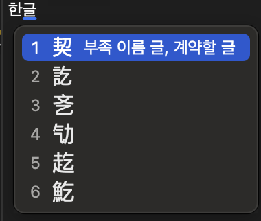
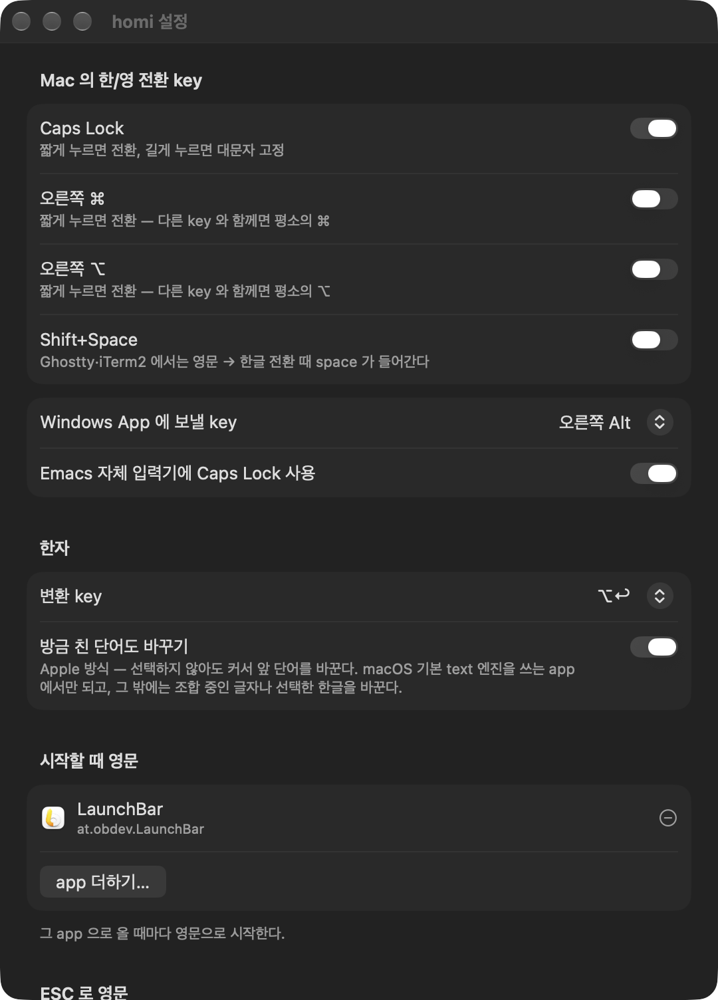

# homi — macOS 두벌식 한글 입력기

**한/영 전환까지 입력기 하나가 맡는 두벌식 입력기.** Caps Lock 을 짧게 누르면 한/영이 바뀌고, 그 다음 key 는 반드시 새 모드로 들어간다.
조합 중인 글자는 app 이 어디서나 알아보는 표준 경로(marked text)로만 보여서, 자모가 풀려 찍히는 일이 구조적으로 없다.

> 주인 한 사람이 매일 쓰려고 만든 개인 프로젝트다. App Store 배포가 아니라 **직접 build 해서 설치**한다.
> 목표는 기능을 늘리는 것이 아니라 **두벌식 입력이 완벽하게 동작하는 것** 하나다.

<p align="center">
  
  &nbsp;&nbsp;
  
</p>

## In English

**homi** is a Korean (2-set / 두벌식) input method for macOS that owns the Korean/English toggle itself instead of switching input sources.
A short tap on Caps Lock (or right ⌘) toggles the mode, and the *next* keystroke is guaranteed to land in the new mode, because the toggle key and the
typing keys travel through the same event stream. Composing syllables are always shown as marked text — the standard path every app implements for CJK —
so homi never rewrites committed text and never leaves jamo scattered (`한글` → `ㅎㅏㄴㄱㅡㄹ`) when an app answers position queries late.

It exists because Apple's bundled Korean IME occasionally does three things: splits a syllable into loose jamo, types the first consonant in English
right after a toggle, and forgets the per-app language. Each has a timing-dependent cause (documented in [`docs/macos-input.md`](docs/macos-input.md));
homi is built so those races cannot happen, and the design is pinned by tests.

- **Scope**: standard 2-set layout only. No 3-set, no archaic Hangul, no autocomplete. Hanja conversion with ⌥↩ (dictionary from libhangul).
- **Requirements**: macOS 27+, current Xcode (Swift 6.4), and a self-signed code-signing certificate named `homi code signing` in your login keychain.
- **Install**: `git clone https://github.com/neutrospec/homi.git && cd homi && scripts/install.sh --register`, log out once, then add *Korean › homi*
  in System Settings › Keyboard › Input Sources. Keep `ABC` in the list as an escape hatch. Grant Accessibility to homi if you want Enter/ESC
  re-sent correctly in terminals and Telegram while composing.
- **Personal project**: built for one person's daily use and installed from source — not an App Store app. MIT licensed. The rest of this README
  and all documentation are in Korean.

## 이런 분께

Apple 한국어 입력기(두벌식)를 쓰면서 아래 셋 중 하나라도 겪어 봤다면 homi 가 답이 될 수 있다.

| 가끔 겪는 증상 | 왜 생기나 (homi 가 조사한 것) | homi 의 답 |
|---|---|---|
| 조합이 깨져 자모가 풀려 찍힌다 (`한글` → `ㅎㅏㄴㄱㅡㄹ`) | Apple 입력기는 marked text 없이 글자를 넣고 `replacementRange` 로 바꿔치기한다. 문서 위치 답이 어긋나는 app 에서 조합이 끊긴다 | 조합 중인 글자는 늘 **marked text** 로 보이고, 이미 확정한 글자는 고쳐 쓰지 않는다 |
| 한글 모드인데 첫 자음이 영문으로 찍힌다 | Caps Lock 전환은 key 를 뗀 뒤 수십 ms 뒤에 다른 통로로 확정된다. 다른 process 의 input source 전환은 실패가 잦다 | **input source 를 바꾸지 않는다.** 한/영은 homi 안의 상태이고, 전환 key 와 타이핑 key 가 같은 event 흐름에 있어 "전환 → 다음 key" 순서가 보장된다 |
| app 마다 한/영 기억을 믿을 수 없다 | system 의 기억은 app 이 아니라 문서 단위이고, 복원 자체가 input source 전환이라 위 문제에 노출된다 | homi 가 **app(bundle ID)마다** 마지막 모드를 직접 기억하고 돌아오면 복원한다 |

"가끔" 생긴다는 것은 timing 에 달린 결함이라는 뜻이라, homi 는 결함이 생길 수 없는 구조를 고르고 그 구조를 test 로 고정하는 쪽을 택했다. 조사 내용은 [`docs/macos-input.md`](docs/macos-input.md)에 증거와 함께 있다.

## 선택하기 전에 — 솔직한 범위

- **macOS 27 이상, 최신 Xcode(Swift 6.4)** 가 필요하다. 그 아래에서는 build 도 설치도 되지 않는다.
- **두벌식 표준만** 지원한다. 세벌식·옛한글·모아치기·자동완성·특수문자 palette 는 없고, 만들 계획도 없다.
- Apple 입력기와 **일부러 다르게** 정한 것이 있다: 같은 자음을 연달아 쳐도 합치지 않고(`ㄱㄱ` 은 `ㄱㄱ`, 된소리는 Shift), ⌥+key 는 영문일 때와 같으며(`⌥a → å`), `` ` `` 는 `` ` `` 그대로다(Apple 은 `₩`). Backspace 는 자소 단위다(`닭 → 달 → 다 → ㄷ`).
- Apple 한국어 입력기와 **함께 쓰지 않는** 것을 전제로 한다. 둘을 섞으면 이상할 때 어느 쪽 증상인지 가릴 수 없다.
- 입력기는 system 전체에 영향을 준다. 설치 전에 `ABC` 입력 소스를 목록에 남겨 두어 비상구를 확보한다 ([비상 탈출](#비상-탈출)).

## 특징

- **한/영 전환 key** — Caps Lock, 오른쪽 ⌘, 오른쪽 ⌥ 의 단독 짧은 누름, Shift+Space 중 여럿을 함께 고른다. 기본은 Caps Lock 과 오른쪽 ⌘.
  Caps Lock 은 **짧게 = 전환, 0.5초 길게 = 대문자 고정** (macOS 처럼 누르고 있는 채로 켜진다). 오른쪽 ⌘·⌥ 는 다른 key 와 함께 쓰면 평소의 ⌘·⌥ 다.
- **전환은 즉시** — 다음 key 부터 새 모드. 조합 중이면 먼저 확정한다. 전환 key 는 수식키라 어느 app 에도 글자가 새지 않는다.
- **한자 변환** — ⌥↩ 가 방금 친 단어(macOS 기본 text 엔진 app 에서), 없으면 조합 중인 글자, 그것도 없으면 선택한 한글을 바꾼다. 사전은 libhangul 의 것이다.
- **app 별 기억** — app 마다 마지막 한/영을 기억하고 돌아오면 복원한다. 처음 보는 app 은 영문으로 시작한다.
- **설정 창** — 전환 key, 한자 key·방식, 그리고 세 가지 app 목록(시작할 때 영문 · ESC 로 영문 · 한/영 전환 없는 app). Windows App·Emacs 에 Caps Lock 을 넘기는 선택지도 있다.
- **app 의 결함에 맞춘 우회**는 재현 증거가 있을 때만 code 에 둔다 — Telegram 의 Enter, terminal 의 Enter·ESC·Tab, Chromium 의 click 확정, Mail 받는 사람 칸의 자동완성, Remote Desktop 의 keyboard layout. 각각의 사유는 [app 원장](docs/apps/)에 있다.
- **타이핑 내용을 기록하지 않는다.** log 에는 상태 전이와 bundle ID 까지만 남는다. 최근 key 기록은 memory 에만 있다가 주인이 요청할 때 file 로 저장한다.

<p align="center">
  
  &nbsp;&nbsp;
  
</p>

## 설치

### 1. 준비물

- macOS 27 이상, Xcode(Swift 6.4 toolchain). 명령줄 도구만으로는 부족하다.
- 시스템 설정 › 키보드 › 입력 소스에 **`ABC` 가 있는지** 확인한다 — 비상구다.
- **자체 서명 인증서 `homi code signing`** 하나. 아래 2 번에서 만든다. 없으면 `install.sh` 는 설치하지 않고 멈춘다.

### 2. 서명 인증서 만들기 (처음 한 번)

build 마다 바뀌는 ad-hoc 서명은 손쉬운 사용 허가를 매번 풀어 버린다. 그래서 homi 는 login 키체인의 자체 서명 인증서로 서명한다.

1. **키체인 접근** app 을 연다.
2. 메뉴 › 키체인 접근 › 인증서 지원 › **인증서 생성…**
3. 이름 `homi code signing`, 신원 유형 **자체 서명 루트**, 인증서 유형 **코드 서명**. 기본값으로 생성한다 (login 키체인에 들어간다).

이름이 정확히 `homi code signing` 이어야 한다.

### 3. build 하고 등록하기

```sh
git clone https://github.com/neutrospec/homi.git
cd homi
scripts/install.sh --register
```

`install.sh --register` 는 release build → `.app` bundle 조립·서명·검증 → `~/Library/Input Methods/homi.app` 설치 → TIS 등록·활성화까지 한다.
처음 등록이면 **logout 한 번**이 필요하다. 다시 로그인한 뒤 시스템 설정 › 키보드 › 입력 소스 › 편집… 에서 **한국어 › homi** 를 추가한다.
input menu 에는 `호` icon 으로 보인다.

### 4. 손쉬운 사용 허가 (권장)

시스템 설정 › 개인정보 보호 및 보안 › **손쉬운 사용**에서 `homi` 를 켠다 (macOS 27 에서는 Device & Data Access 아래).
조합 중 Enter·ESC 를 일부 app(Telegram, terminal)에 다시 보내는 데 쓰고, 전환 key 를 눌렀다 떼는 사이의 다른 입력을 더 정확히 알아보는 데도 쓴다.
없어도 입력은 된다 — 그 app 들에서 조합 중 Enter·ESC 가 app 으로 그대로 넘어갈 뿐이다.

### 5. 같이 켜 두면 안 되는 것

- **Apple 한국어 입력기**는 입력 소스에서 뺀다.
- **입력 소스를 바꾸는 다른 도구**(Hammerspoon·Karabiner 의 입력 소스 전환 등)는 끈다 — 그 도구가 ABC 로 바꾸면 homi 가 밀려난다.
- 시스템 설정 › 키보드 › **"문서의 입력 소스로 자동 전환"** 은 끈다 — 켜 두면 system 이 문서마다 input source 를 되돌린다.
- "Caps Lock 키로 ABC 입력 소스 전환" 은 켜도 꺼도 된다. homi 가 선택된 동안에는 homi 가 Caps Lock 을 먼저 받는다.

### 업데이트 · 제거

```sh
git pull && scripts/install.sh      # 이미 등록돼 있으면 --register 없이. 실행 중인 homi 를 교체하고 다음 입력 때 새 binary 가 뜬다
```

제거는 입력 소스 목록에서 homi 를 빼고 `~/Library/Input Methods/homi.app` 을 지운 뒤 logout 한다.

## 사용법

### 한/영

- **Caps Lock 짧게** 또는 **오른쪽 ⌘ 짧게** — 한/영 전환. 어느 app 에서든 다음 key 부터 새 모드다.
- **Caps Lock 0.5초** — 대문자 고정 (떼기 전에 켜진다, 불빛도 따라간다). 표시는 macOS 의 것을 쓴다.
- menu bar 의 **한 / A** 가 지금 모드다. 모드가 바뀌면 커서 옆에 말풍선이 잠깐 뜬다. 한/영 전환 없는 app 에서는 `–`.
- app 을 오가면 그 app 에서 마지막에 쓰던 모드로 돌아간다.

### 한자

- 한글을 치고 **⌥↩** — 방금 친 단어 중 사전에 있는 가장 긴 것이 밑줄로 바뀌며 후보 창이 뜬다 (`나는한자` → `한자`). 다시 ⌥↩ 를 누르면 더 짧은 단어로.
  이 "방금 친 단어" 방식은 TextEdit·Notes·Mail 처럼 macOS 기본 text 엔진을 쓰는 app 에서만 되고, 그 밖에서는 조합 중인 글자나 선택한 한글을 바꾼다.
- 후보 창: **1–9** 로 고르기, **↑↓** 옮기기, **←→** 쪽 넘기기, **Enter·Space** 확정, **ESC** 취소(한글 그대로). 다른 key 를 치면 한글을 그대로 두고 평소처럼 입력된다.
- 한자 key 는 설정에서 오른쪽 ⌥ 또는 오른쪽 ⌘ 짧게로 바꿀 수 있다 (한/영 전환에 쓰지 않는 쪽만).

### 설정 창

menu bar 의 **한/A 를 눌러 "homi 설정…"**, 또는 input menu 의 **"설정…"**. 바꾸는 즉시 저장되고 다음 key 부터 쓰인다.

| 항목 | 뜻 | 기본값 |
|---|---|---|
| Mac 의 한/영 전환 key | Caps Lock · 오른쪽 ⌘ · 오른쪽 ⌥ · Shift+Space 중 여럿 | Caps Lock, 오른쪽 ⌘ |
| Windows App 에 보낼 key | Windows App 에서만 Caps Lock 을 오른쪽 Alt 또는 한/영 key 로 넘긴다 | 안함 |
| Emacs 자체 입력기에 Caps Lock 사용 | Emacs 에서만 Caps Lock 을 F18 로 넘긴다 (Emacs 쪽은 `toggle-input-method` 에 연결) | 꺼짐 |
| 한자 — 변환 key · 방금 친 단어도 바꾸기 | ⌥↩ 또는 남는 오른쪽 수식키 · Apple 식 단어 변환 사용 여부 | ⌥↩ · 켜짐 |
| 시작할 때 영문인 app | 그 app 으로 올 때마다 영문으로 시작 | LaunchBar |
| ESC 로 영문인 app | ESC 를 누르면 확정 → 영문 → ESC 는 app 으로 | VS Code(·Insiders), Obsidian, iTerm2, Wave, Ghostty, IntelliJ(·CE) |
| 한/영 전환 없는 app | 조합도 전환도 하지 않고 key 를 그대로 넘긴다. 표시는 `–` | Windows App, Emacs |

### app 마다 알아 두면 좋은 것

| app | homi 가 하는 일 | 알아 둘 것 |
|---|---|---|
| Terminal · iTerm2 · Ghostty · Wave | 조합 중 Enter·ESC·Tab 은 확정한 뒤 새 event 로 다시 보낸다 | 손쉬운 사용 허가가 필요하다. Shift+Space 전환은 영문 → 한글 때 space 가 샌다 |
| Telegram | 조합 중 Enter 를 확정 뒤 다시 보내 전송이 된다 | 같은 허가 |
| Chrome · Electron app (VS Code·Obsidian·ChatGPT…) | click 때 page 가 스스로 확정한 것을 다시 넣지 않는다 | |
| Mail 받는 사람 칸 | 자동완성이 음절을 지우지 않게 음절 경계에서 두 음절을 함께 넣는다 | |
| Windows App | key 를 그대로 넘기고 한/영은 원격 Windows 의 입력기가 맡는다 | 설정에서 Caps Lock 을 오른쪽 Alt 로 넘길 수 있다 |
| Remote Desktop | 이 Mac 의 keyboard layout 으로 한/영을 알린다 | **원격 Mac 은 두벌식에 둔다** |
| Emacs | 한/영 전환 없는 app 이 기본 — Emacs 자체 입력기를 쓴다 | Caps Lock 을 F18 로 넘기는 옵션 ([설정 예](docs/apps/emacs.md#caps-lock-전달-2026-10-29)) |

확인한 app 들의 기록은 [`docs/apps/`](docs/apps/)에 version·날짜와 함께 있다.

### 비상 탈출

입력기가 고장나면 타이핑 자체가 막힌다. **menu bar 의 input menu 에서 `ABC` 로 바꾸면** 바로 빠져나온다. 그래서 `ABC` 를 목록에서 빼지 않는다.
그래도 안 되면 `~/Library/Input Methods/homi.app` 을 지우고 logout 한다. `imklaunchagent` 는 죽이지 않는다 — 실행 중인 모든 app 이 입력기를 잃는다.

### 이상할 때

input menu 의 **"최근 key 기록 저장"** 을 곧바로 누르면 `~/Library/Logs/homi/` 에 최근 key event 와 상태 전이가 저장된다 (타이핑한 글자는 들어 있지 않다).
system log 는 `/usr/bin/log stream --level debug --predicate 'subsystem == "com.unocult.inputmethod.homi"'` 로 본다.

## 구조

SwiftPM package 하나. `.xcodeproj` 는 없다 — build·test·설치가 CLI 로 끝난다.

| module | 역할 | 아는 것 |
|---|---|---|
| `HangulCore` | 두벌식 자판 mapping + 조합 state machine. 자모·편집 명령 → 확정 문자열 + 조합 중 문자열 | 아무 framework 도 모른다 |
| `InputSession` | key 해석, 수식키 tap 의 뜻, 모드, app 별 기억과 규칙, 설정, 최근 기록 | `HangulCore` 만 |
| `homi` | IMK glue — `IMKServer`, `HomiInputController`, NSEvent 변환, menu bar, 설정 창 | 위 둘 + AppKit·InputMethodKit |

```
NSEvent ─▶ HomiInputController ─▶ InputCoordinator ─▶ Session ─▶ HangulCore
                 (IMK, 얇음)       app 식별·mode 준비     판단·Action 목록   조합 규칙
                       ◀────────── Client ◀──────────────┘
                              marked text · insertText
```

설계 결정은 일곱 개다 (근거는 [`AGENTS.md`](AGENTS.md)):
입력기 하나가 한/영을 모두 처리한다 · 모드의 source of truth 는 입력기 내부 상태 하나다 · 판단은 key event 안에서 동기로 끝낸다 · key 처리 중 system input source 를 건드리지 않는다 ·
조합 중인 글자는 marked text 로 보인다 · 조합 엔진은 순수하다 · IMK 층은 얇다.

검증은 두 층이다. `HangulCore`·`InputSession` 은 순수 Swift 라 `swift test` 가 조합 규칙([`docs/spec.md`](docs/spec.md))과 "key 순서 → client 에게 할 일"을 고정한다 (2026-11-03 기준 382개).
IMK 층은 test client 창(`scripts/probe.sh`)과 실제 app 에서 확인한다 — 입력기가 client 에게 무엇을 하는지는 추측하지 않고 거기서 본다.

## 개발

```sh
swift build && swift test               # 모든 변경의 최소 관문
scripts/install.sh                      # release build → 서명 → 설치 → 실행 중인 homi 교체
scripts/probe.sh                        # test client 창 — key event, 입력기의 호출, input source 변화를 시간순으로
swift run tis list|current|watch        # input source 조회·관찰 (register·enable·select 도 있다)
swift run caps-probe --seconds 90       # Caps Lock 의 물리 HID 와 remap 뒤 신호를 읽기 전용으로 관찰
```

| 문서 | 내용 |
|---|---|
| [`AGENTS.md`](AGENTS.md) | 목적·결정·규칙. 이 프로젝트의 source of truth |
| [`docs/spec.md`](docs/spec.md) | 두벌식 조합 규칙 — 엔진 test 가 그대로 고정한다 |
| [`docs/macos-input.md`](docs/macos-input.md) | 배운 macOS 입력 구조와 그 증거 (✅ 확인 / 🔶 추정) |
| [`docs/apps/`](docs/apps/) | app 원장 — app 마다 확인한 사실·homi 의 우회·version |
| [`docs/lessons.md`](docs/lessons.md) | 고친 결함의 증상·원인·증거·대응 |
| [`docs/stability-review.md`](docs/stability-review.md) | 개선 안건의 채택·보류·기각 |
| [`docs/research/`](docs/research/) | 외부 자료·공개 코드·Apple 입력기 조사 |

이 프로젝트는 macOS 입력 구조를 배우는 과정이기도 하다. 결정마다 "왜"를 적고, 확인한 사실과 추정을 구분한다.

## 라이선스 · 감사

- homi 는 [MIT License](LICENSE) 다.
- 한자 사전 `hanja.txt` 는 [libhangul](https://github.com/libhangul/libhangul) 의 것이다 (BSD 3-clause, © 2005–2006 Choe Hwanjin). 저작권 표시는 file 머리에 그대로 있다.
- "입력기 하나가 안에서 한/영" 을 먼저 보여 준 선행 입력기들 — [ongeul](https://github.com/hiking90/ongeul), [PriType](https://github.com/Meapri/PriType-Swift), [SokIM](https://github.com/kiding/SokIM), [gureum](https://github.com/gureum/gureum).
