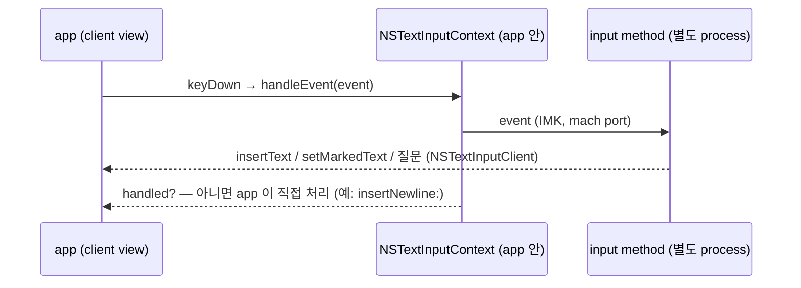

# macOS 입력 구조 — 배운 것

주인이 이 프로젝트로 배우는 macOS text input 의 구조. 확인된 사실과 추정을 구분하고 확인 방법을 붙인다.
app 하나에만 딸린 사실은 app 원장(`docs/apps/`)에, 고친 결함의 경과는 `docs/lessons.md` 에 있다.

- ✅ 확인 — 실험(`tis`·`probe` log, homi 기록, crash report)이나 source 로 봤다
- 🔶 추정 — 근거는 있으나 아직 확인하지 않았다

## key 하나가 글자가 되는 길



- input method 는 app 과 **다른 process** 다. app 안의 IMK 가 mach port 로 대화한다. ✅ (probe 의 IMK error message)
  새 source·새 client 와 처음 주고받을 때마다 `error messaging the mach port for IMKCFRunLoopWakeUpReliable` 이 나왔고, 매번 무해했다. ✅
- 입력기의 호출(`insertText`·질문)은 app 의 `handleEvent` **안에서** 온다 — app 은 입력기가 답할 때까지 기다린다. 한 key 에 11–33ms (probe 의 log 비용 포함). ✅
- 예외: input source 가 바뀔 때의 확정은 key 처리 **밖에서** 비동기로 온다. ✅ (아래 Caps Lock)
- 입력기가 NO(안 먹었다)를 돌려주면 context 가 key 를 그 아래 keyboard layout 으로 문자로 바꿔 `insertText` 한다.
  Return·Delete 는 `doCommand`(`insertNewline:`·`deleteBackward:`)가 된다. ✅
- `NSTextInputContext` 는 **생성되자마자** client 에게 `validAttributesForMarkedText` 를 묻는다. ✅ (probe crash report — 이 질문을 기록하려다 무한 재귀)
- TSM(Text Services Manager, HIToolbox)은 daemon 이 아니라 **app process 안의 library** 다 — Caps Lock LED 를 조절하는 TSM 의 log 가 app 의 stderr 에 찍힌다. ✅

## input source 와 keyboard layout

- System Settings 의 "입력 소스" 목록 항목이 TIS input source 다. ✅ (`tis list`)
  - **keyboard layout** — key → 문자 표. 조합 없음. `com.apple.keylayout.ABC`
  - **input method** — 조합하는 program. 그 안의 **mode** 가 실제로 선택되는 단위다. `com.apple.inputmethod.Korean` 안의 `….Korean.2SetKorean`
- **input method 아래에도 keyboard layout 이 따로 깔린다** ✅ (`tis current`). Apple 두벌식 아래는 숨은 layout `com.apple.keylayout.2SetHangul`
  (key 마다 자모 하나를 낸다), homi 아래는 ABC. 입력기는 IMK 의 `overrideKeyboardWithKeyboardNamed:` 로 자기 아래 layout 을 고른다 —
  homi 는 activate 때 ABC 로 둔다 (Remote Desktop 의 한글 모드만 `2SetHangul`, 아래). 고를 layout 이 입력 소스 목록에 켜져 있을 필요는 없다. ✅
- `NSEvent.characters` 는 이 layout 이 정한다 — 같은 `kc=5` 가 ABC 에서 `"g"`, 두벌식에서 `"ㅎ"`. 그래서 homi 는 `keyCode`(물리 위치)로 판단한다. ✅ (probe)
- ASCII 입력 가능(ASCII-capable)한 것은 `ABC` 뿐이다. system 은 "가장 최근의 ASCII-capable source" 를 따로 기억한다 — 그 쓰임새(비밀번호 칸 등)는 🔶.
- TIS API 는 main thread 에서만 부른다 — 병렬 test 가 여러 thread 에서 `TISCreateInputSourceList` 를 부르자 process 가 abort(signal 6)했다. ✅
- **등록**: `TISRegisterInputSource` 뒤 parent 에 `TISEnableInputSource` 가 성공(0)을 돌려주고도 parent 는 꺼진 채였고 mode 만 켜졌다
  (조사의 qingjian#209 와 같은 증상). menu 에서 homi 를 고른 뒤에는 parent 도 켜졌다. ✅ / 이유 🔶
- system 은 입력기를 **고르는 순간** 띄운다 (부모 process = launchd). 입력칸이 바뀔 때마다 `activateServer`·`deactivateServer` 가 오고,
  같은 app 안에서도 3ms 안에 deactivate → activate → deactivate 가 몰려오는 일이 있다. ✅

### 문서별 input source 복원 재확인 (2026-10-31)

주인은 homi 를 골라도 다른 창에서는 ABC 로 돌아가 있어 다시 선택하는 일이 종종 있다고 보고했다.
homi 내부의 한/영 mode 와 **macOS 의 ABC ↔ homi 선택은 별도 상태**다. 내부 전환에 TIS 를 쓰지 않는 설계는
macOS 가 focus 전환 때 다른 source 를 복원하는 경로까지 없애지는 않는다.

- 02:47 KST, `com.apple.HIToolbox`의 `AppleGlobalTextInputProperties.TextInputGlobalPropertyPerContextInput`이 true 였다.
  이어 System Settings → Keyboard → Input Sources 의 **Automatically switch to a document’s input source**도 켜짐(`1`)으로 확인했다.
  2026-09-25 에 껐다는 기록과 달랐다. 언제·누가 바꿨는지, OS update 가 관여했는지는 확인하지 않았다. ✅ 현재 저장값·UI
- [Apple 설명](https://support.apple.com/en-gb/guide/mac-help/mchl84525d76/mac)에 따르면 이 옵션은 문서를 닫기 전까지
  그 문서에서 고른 input source 를 다시 사용한다. 주인이 보고한 창별 ABC 복귀와 일치하는 기능이다.
- 주인이 **끄고 비교하기**를 승인했다. UI 에서 해당 옵션만 해제했고 02:53 KST 이후 저장값 false 를 두 번 확인했다.
  전환 후 UI 조회 중 sheet·System Settings 가 닫혀 꺼짐 표시 자체는 재확인하지 못했다. 현재 TIS 는 homi 선택·하위 ABC layout 이며,
  homi PID `85292`와 Caps Lock·Windows 오른쪽 Alt·Emacs 전달 설정은 유지됐다. 제품 코드·설치본은 바꾸지 않았다.
- 창별 source 자동 복원을 제거한 **비교 시작점**이다. [Telegram 의 첫 key 영문·초성 누락](apps/telegram.md)과
  [T3 의 menu 항목 누락](apps/t3-code.md)이 해결됐다는 증거는 아직 없다. 특히 이 설정만으로 menu 항목이 사라졌다고 설명하지 않는다.
- 이후 [Telegram 의 첫 초성 누락이 재발](apps/telegram.md#자동-복원-해제-뒤-재발-2026-10-31)했고, 조사 때 저장값도 false 였다.
  자동 복원 해제만으로 누락을 해결하지 못했다. 첫 key 영문·T3 menu 누락의 해제 후 경과는 별도 확인이 필요하다.

환경 설정 기록은 확인 시점의 사실이다. 재발 조사에서는 예전의 꺼짐 기록으로 현재 source 전환 가능성을 배제하지 않고 현재값부터 재확인한다.

### system source 전환 UI 와 homi 표시 (2026-10-31)

- `⌃Space`의 source 전환과 homi 내부 한/영 전환은 별도 경로다. 현재 homi 설정은 Caps Lock 이며,
  `Session`은 Control 을 포함한 일반 key 를 app·system 으로 넘긴다. ✅ 현재 설정·코드
- [Apple 의 system text cursor 문서](https://developer.apple.com/documentation/appkit/adopting-the-system-text-cursor-in-custom-text-views)는
  커서 옆에 현재 input source 를 표시하고 언어 선택 UI 를 펼치는 accessory 를 설명한다. ✅ 문서
  homi 의 `ModeHUD`도 내부 mode 가 바뀌면 `한/A`를 커서 옆에 그린다. 따라서 **표시 위치만으로 어느 전환인지 구별하지 않는다.**
  [ChatGPT 보고](apps/chatgpt.md#복귀-뒤-source-전환-지연-보고-2026-10-31-미해결)는 사용 key·실제 source·UI 를 대응시켜야 한다.
- [Apple Developer Forums 의 사용자 재현 보고](https://developer.apple.com/forums/thread/841799)는 macOS **26.5.2**에서
  Control·Space 를 거의 동시에 뗄 때 source 가 바뀌었다가 되돌아오는 경우를 제시한다. 작성자는 합성 event 와 TIS 관찰을 비교했다.
  **Apple 의 확인·공식 원인 설명이 아니며, 현재 macOS 27.2·homi 에서 재현한 결과도 아니다.**
  `⌃Space` 후 선택 유지 실패를 조사할 별도 후보로 두고, menu 누락·focus 문제·Caps Lock 결함 전체와 합치지 않는다.

### input menu 의 비활성·누락 (2026-10-09, 미해결)

- 주인: homi 가 흐려져 선택되지 않거나 menu bar 의 input menu 에서 사라졌다. 모든 app 에서 이상한 때도,
  app 을 옮기면 회복되는 때도 있었고, 잠금화면을 다녀오면 회복되기도 했다. ✅ (사용 관측)
- user·system 두 설치 위치에서도 같은 증상이 있었다. 설치 위치 변경은 해결의 증거가 아니다. ✅ (주인)
- System Settings 의 등록까지 사라졌는지는 확인하지 않았다. menu 의 가용성 변화와 등록 소실을 같은 현상으로 판단하지 않는다.
  당시 Secure Keyboard Entry 상태·TIS 속성·process 상태의 동시 관찰이 없어 원인은 아직 모른다.
- 2026-10-30 [T3 Code 의 메시지 입력칸에서 항목 누락이 재발](apps/t3-code.md#input-menu-에서-homi-누락-2026-10-30-미해결)했다.
  같은 process·controller 표시 ID 의 선택 해제와 회복 log 를 확보했다. TIS·Secure Event Input 조회는 회복 뒤라 원인은 계속 미확정이다.
- 2026-10-31 [Orca 에서 누락 보고 당시 enabled·process 유지와 Secure Event Input=false 를 확보](apps/orca.md#input-menu-의-homi-누락-보고와-회복-2026-10-31-미해결)했다.
  주인은 웹에서 ⌘Tab 복귀 직후 없었고, 그 창에서 기다리다가 다시 선택할 수 있었다고 정정했다. 다른 app 을 다시 다녀와 회복했다고 해석하지 않는다.
  접근성 menu 조회에는 ABC 만 있었지만 화면 전체·동일 입력칸 focus 는 미확인이라 보기 착오와 정상적인 context 제한도 배제하지 않는다.

다음 재발에서는 app 이동·잠금·재설치로 상태를 바꾸기 전에, 시각·app bundle ID 와 `tis list --all`·`tis current`, homi PID·실행 경로·binary 식별,
HID mapping 을 함께 확보한다. System Settings 에도 사라졌는지와 Secure Keyboard Entry 상태를 확인할 읽기 전용 관찰을 준비한다.

- parent·mode 의 enabled 와 현재 source/layout 은 함께 읽는다. enabled 만으로 menu 의 선택 가능 여부를 판정하지 않는다.
- `kTISPropertyInputSourceIsSelectCapable` 은 현재 상태와 무관한 **static capability**다. gray menu 의 detector 로 쓰지 않는다.
  ✅ (macOS 27 SDK `TextInputSources.h` · 2026-10-09)
- `IsSecureEventInputEnabled()` 는 어느 process 에서든 Secure Event Input 이 켜졌으면 true 다. thread safe 하지 않으므로 main thread 에서 읽는다.
  true 만으로 homi 비활성의 원인을 확정하거나 켠 app 을 알아낸 것은 아니다. ✅ (같은 SDK `CarbonEventsCore.h`)
- `kTSMDocumentEnabledInputSourcesPropertyTag`는 문서에서 허용할 source 를 전역 enabled 목록의 일부로 제한한다.
  하나만 허용하면 그 source 를 자동 선택한다. `TSMGetActiveDocument`는 호출한 app 의 context 를 가리키므로 외부 probe 의 값을 대상 app 의 값으로 읽지 않는다.
  ✅ (macOS 27.2 SDK `TextServices.h` · 2026-10-31). Secure Event Input 과 이 제한의 조작은 [Chromium 코드에서도 별개](apps/engines/chromium.md#입력-context-와-source-제한-2026-10-30)다.
- `tis watch`와 homi 의 source 알림 log 는 callback 때의 현재 source 를 읽는다. 알림 도착 사이에 여러 전환이 있으면 중간 상태를 놓칠 수 있다.
  ✅ (`Watcher.report`·`SourceWatcher.sourceChanged` + [Orca 동시 관측](apps/orca.md#input-menu-의-homi-누락-보고와-회복-2026-10-31-미해결)).

이 관찰을 typing 경로에 넣거나 system 상태를 바꾸지 않는다. 관찰 중 `imklaunchagent` 를 종료하지 않는다.

## client 호출은 IMK lifecycle 을 재진입시킬 수 있다

- client 를 부르는 동안 `commitComposition`·deactivate·activate 가 끼어들 수 있다.
  macOS 27 의 실제 관측은 [PriType #15](https://github.com/ghostface2232/PriType-Swift/pull/15)에 있다.
  homi 에 같은 callback 순서를 주입하자 한자 질의는 Swift exclusive access 충돌로 abort 했고,
  `insert → mark` 도중 deactivate 는 Session 이 비었는데 client 에 mark 를 다시 남겼다. ✅ (2026-10-09, Debug·Release regression)
- `SessionDriver` 가 질의·상태 변경·client 반영을 함께 감싸고, 재진입한 종료 요청을 경계 끝에서 처리한다.
  같은 경계 안의 deactivate → activate 는 명시적인 commit 요청이 없을 때만 상쇄한다. 지연된 후보 표시는 controller 와 조합 세대가 맞는지 확인한다.
- macOS 26 에서 다른 process 의 input source 전환에 deactivate 가 빠진 관측이 있다
  ([Squirrel #1140](https://github.com/rime/squirrel/issues/1140), [대응 #1142](https://github.com/rime/squirrel/pull/1142)).
  homi 도 source 알림에서 bound client 의 조합을 정리한다. ✅ (callback 누락을 주입한 regression)
  대상은 마지막으로 활성화되거나 event 를 받은 weak controller 하나다. 모든 종료 순서와 실제 app 을 검증한 것은 아니다.
  이것이 menu bar 의 비활성 증상을 고쳤다는 증거는 아직 없다.

### client 호출 단계의 관측

controller 표시 ID 는 2026-10-31 12:44 설치본부터 process PID·UUID 와 생성 번호다.
[이전 hash 방식의 한계와 교정](lessons.md#controller-진단-id-의-수명-구분)을 따른다. 이 ID 는 controller 수명을 구분하며 실제 입력칸의 소유권을 증명하지 않는다.

`SessionDriver.clientTrace` 는 마지막 안전한 경계에서 옮긴 `composing`·`candidates` boolean 과 호출 metadata 만 가진다.
`perform`·`finish` 의 mutating call 이 반환한 뒤 cache 를 갱신한다. callback 에서 Session 을 직접 읽거나 client 에 더 묻지 않는다.
실제 `Client` 의 fake proxy callback 과 mutating 질의 test 로 exclusivity 충돌 없이 읽히고 추가 질의가 없음을 확인했다. ✅ (2026-10-09, Debug·Release)

| 기록 | 의미 · 한계 |
|---|---|
| `event` | driver 의 동기 transaction ID. key 외의 명시적 commit·종료 flush 에도 붙으므로 물리 key 번호가 아니다 |
| `batch`·`action` | client 에 보낼 목록과 그 안의 순서. 목록 전체를 첫 IPC 전에 계획한다 |
| `localMarkPlan` | 가장 최근 계획한 mark 의 token. `insert(old) → mark(next)` 의 insert 중에도 next 계획을 볼 수 있다 |
| `markAttempt`·`markReturn` | 마지막 mark 호출의 시작·정상 반환 token. 반환은 renderer 적용·확정의 증거가 아니다 |
| `call(kind,depth,…)` | 지금 실행 중인 insert·mark·query·layout 과 중첩 깊이 |
| `returnedCall` | `.return` log 에서 방금 반환한 호출 ID. 이때 `call(…)` 은 이미 복구된 바깥 frame 이다 |
| `inputDepth`·`mutation`·`explicitEnd` | 실제 입력 handler 안인지, Session 변경 중인지, 명시적 종료가 대기·flush 중인지 |

token 은 글자의 동일성·DOM 입력칸·callback 의 적용 대상을 증명하지 않는다. 같은 글자와 빈 mark 도 새 계획이고,
조합이 끝난 뒤에도 이력은 남는다. cached state 는 진행 중 mutation 이전의 값일 수 있으며 `composing=false, candidates=true` 도 가능하다.
lifecycle `.return` 은 callback 반환이다. 경계 끝의 pending commit 완료를 뜻하지 않는다.

lifecycle snapshot 은 info log 와 memory ring buffer 에, client 호출의 시작·반환은 debug log 에 남긴다.
새 snapshot 에 글자·key code·문서 위치는 없다. 기록의 추가 비용이 timing 을 바꿀 수 있으므로 관측된 순서를 일반화하지 않는다.
native `probe --check-input-manual` 은 주인이 선택한 homi·실제 `가` 입력으로 준비한 뒤 자기 NSTextView 에서 기본 입력·insert/mark callback·입력칸 이동을 검사한다.
도구가 source 를 고르거나 system 에 key 를 post 하지 않는다. context injection 은 실제 lifecycle 도착 단계와 log 를 대조해야 한다.

일반 probe 의 실제 입력에서 다음 순서를 확인했다. ✅ (2026-10-09 12:37:33 KST, 같은 controller 의 event 6·batch 6, 내용 없는 homi trace)

| 단계 | `localMarkPlan` | `markAttempt` | `markReturn` |
|---|---|---|---|
| insert 시작·반환 | 4 | 3 | 3 |
| 다음 mark 시작 | 4 | 4 | 3 |
| 다음 mark 반환 | 4 | 4 | 4 |

또한 12:37:43 의 deactivate 는 `inputDepth=0, composing=true` 로 시작했고, 종료 insert 는 `explicitEnd=true, composing=false` 인 별도 transaction 으로 실행됐다.
이 표의 입력 중에는 commit·deactivate·activate 의 재진입을 관측하지 않았다. 계획·호출 이력의 연결을 확인한 것이며 callback 의 확정 대상은 아직 가르지 못했다.
주인의 일반 입력 확인과 자동 검사 중단의 범위는 [작업 기록](lessons.md#2026-10-09-activation-교정callback-관측)에 있다.

## Apple 한국어 입력기가 하는 일

### marked text 없이 확정하고 바꿔치기한다

probe run 1 (NSTextView), `한글` + Return:

```
keyDown kc=5  (g)  → insertText "ㅎ" [314E] repl={-,0}     확정해서 넣는다
keyDown kc=40 (k)  → insertText "하" [D558] repl={0,1}     방금 넣은 0번 글자를 바꿔치기
keyDown kc=1  (s)  → insertText "한" [D55C] repl={0,1}
keyDown kc=15 (r)  → insertText "한" repl={0,1}, insertText "ㄱ" [3131] repl={-,0}
keyDown kc=46 (m)  → insertText "그" [ADF8] repl={1,1}
keyDown kc=3  (f)  → insertText "글" [AE00] repl={1,1}
keyDown return     → insertText "글" repl={1,1} → doCommand insertNewline: → insertText "\n"
```

- 교과서 방식(`setMarkedText` 로 밑줄 친 조합 중 글자를 보이다가 확정 때 `insertText`)이 아니다.
  **확정해서 넣고, `replacementRange` 로 앞 글자를 바꿔치기** 한다. `setMarkedText` 호출이 한 번도 없다. ✅
- 이 방식은 입력기가 문서 위치를 정확히 알고, client 가 `replacementRange` 를 정확히 지켜야 성립한다. 문서 model 이 복잡하거나 비동기인
  client(웹·Electron·terminal)에서 위치가 어긋나면 자모가 따로 확정된다 — **풀어쓰기와 같은 모양** 🔶.
  Telegram(NSTextView)에서 Apple 두벌식이 초성을 잃은 것(`아` → `ㅏ`, 주인)도 이 방식이 어긋난 모양으로 본다 — homi 로는 재현되지 않았다 🔶. 결정 5 의 근거다.
- 입력기가 client 에게 묻는 것은 `selectedRange`(key 마다 여러 번)·`hasMarkedText`·`validAttributesForMarkedText` 뿐이다.
  문서 내용은 묻지 않고 조합 중인 음절의 위치를 cursor 위치로 계산한다. ✅ (run 2)
  이 입력기는 app 의 text 를 cache 하는 비공개 IMK class 위에 있고 `unreliableApps` 같은 목록을 둔다 (조사 → `docs/research/app-compat-and-hangul.md` §3).
- 낱자모는 호환 자모(U+3131–318E), 음절은 완성형(U+AC00–D7A3)이다. Backspace 도 자모 단위의 바꿔치기이고 마지막 자모는 app 이 지운다(`deleteBackward:`).
  도깨비불은 `insertText` 두 번(`일`+ㅓ → `이` 바꿔치기 + `러`). Return 은 조합 중인 글자를 같은 자리에 다시 넣어 확정하고 먹지 않는다 → app 이 `insertNewline:`. ✅ (run 2)

### Caps Lock 전환은 key 와 다른 통로로 늦게 온다

probe run 1, 한→영:

```
41.212  flags   kc=57 capslock mods=⇪     누름 — app 은 "caps lock 켜짐" 을 받는다
41.245  flags   kc=255 mods=-             실제 key 가 아닌 kc=255 — system 이 caps lock 을 도로 끄는 합성 event
41.277  flags   kc=57 capslock mods=-     뗌
41.279  sys source → com.apple.keylayout.ABC   전환 확정: 누른 지 67ms 뒤
41.614  keyDown kc=5 chars="g"  ctx=ABC   335ms 뒤에 쳐서 새 source 로 처리됨
```

- 짧게 누르면 전환, 길게 누르면 대문자 고정이라 system 은 떼는 순간을 봐야 전환을 확정한다 — 누름 → 확정 43–106ms, 매번 다르다. ✅ timing / 해석 🔶
- 전환은 key event 와 **다른 통로**(TIS 알림 → app 의 context)로 온다. 두 통로 사이에 순서 보장이 없으면 전환 직후 친 key 가 이전 source 로 처리된다 —
  "한글 모드인데 첫 자음이 영문" 의 유력한 기전이다 🔶. probe 에서는 재현하지 못했다 — 전환 뒤 200ms 넘게 지나서 쳤다.
- 조합 중에 전환하면 입력기가 비활성화되며 스스로 조합을 확정하는데, 그 `insertText` 는 어느 `handleEvent` 에도 속하지 않는다 —
  다음 key 와의 순서가 보장되지 않는다 🔶 (run 2: `flags kc=57` → `insertText "글" repl={11,1}` → `sys source → ABC`).
- **"문서의 입력 소스로 자동 전환"** 이 켜져 있으면 app 전환 때 system 이 문서별 input source 를 되살린다 — `app active` 18ms 뒤 `ctx source → ABC`.
  그 사이에 친 key 는 이전 source 로 간다 🔶 — 또 하나의 "첫 글자" 경로. homi 를 고른 채 돌아와도 ABC 를 되살렸다 ✅ — 그래서 이 설정을 껐다.
- input source 를 바꾸는 key 는 app 에 오지 않는다 — ⌘Tab 의 Tab, ⌃Space 의 Space. app 은 수식키 flags 만 보고, 돌아오면 `flags kc=0` 합성 event 가 온다. ✅
  → 수식키 tap 을 입력기가 본 event 만으로 판정하면 ⌘Tab 도 tap 이 된다.

## homi 의 방식

- **조합 중인 글자는 `setMarkedText` 로 보이고, 음절이 넘어갈 때만 `insertText` 로 확정한다.** `replacementRange` 는 늘 NSNotFound. ✅ (probe run 3)

  ```
  ㅇ ㅜ ㄹ   → setMarked "ㅇ" → "우" → "울"
  ㅣ         → insertText "우" + setMarked "리"     도깨비불
  space      → insertText "가" → (app 이) " "
  ㄴ ⌫       → setMarked ""                        조합 중 Backspace 는 homi 가
  ⌫          → doCommand deleteBackward:           조합이 없으면 app 이
  ```

- marked text 안의 선택을 `{글자 수, 0}`(커서를 글자 뒤로)으로 보냈는데 app 은 `{0, 글자 수}`(전체 선택)로 받았다 — IMK 가 중간에서 바꾼 것으로 보인다 🔶.
  당시 probe 에서 화면에 드러난 문제는 없었다 (2026-09-25).
- `IMKTextInput.insertText` 의 "현재 selection" 지정은 위치·길이가 **모두** NSNotFound 다.
  `setMarkedText` 는 위치가 NSNotFound 인 것으로 설명한다. ✅ (macOS 27 SDK `IMKInputSession.h`)
  계약대로 바꾼 실험은 Chrome 전환·입력칸 이동의 실패를 해결하지 못했다. 현재는 기존 `{NSNotFound, 0}` 으로 복귀했다.
  실제 IMK 전달과 SDK 계약의 차이는 [교정 보류 기록](lessons.md#imk-현재-selection-의-range-계약이-구현과-다르다-2026-10-09-교정-보류)에 둔다.
- **전환 key 는 remap 한 수식키다.** Caps Lock 은 homi 가 선택된 동안 `UserKeyMapping`(공개 API `IOHIDEventSystemClientSetProperty`, 관리자 권한 없이 ✅)으로
  오른쪽 Control 로 바꿔 flagsChanged 로 받는다. 처음엔 F18 로 바꿔 keyDown 으로 받았는데 terminal 에 F18 의 문자가 샜다 (아래 "먹었다" 판정) —
  그래서 글자를 만들지 않는 수식키로 바꿨다. homi 는 `TICapsLockLanguageSwitchCapable` 을 선언하지 않으므로 선택된 동안 system 의 Caps Lock 전환이 끼지 않는다. ✅
- **수식키 tap 은 app 앞에서 관찰한 누름·뗌 사이의 활동으로 판정한다.** 입력기가 못 본 ⌘C 의 C 도 센다.
  2026-10-29 의 [gesture 연결과 fallback](#quartz-와-imk-사이-modifier-event-의-연결-2026-10-29)을 따른다. ✅ 코드·실제 IMK 비교
  권한이 없거나 press 연결이 모호하면 기존 `CGEventSource.counterForEventType` 비교를 유지한다. 이 API 는 권한 없이 읽을 수 있지만
  event 당시의 snapshot 은 아니므로 [시간 구간의 문제](stability-review.md#caps-lock-전환-code-review-2026-10-29)가 남는다.
  Caps Lock 을 단독으로 0.5초 누르면 떼기 전에 대문자 고정을 뒤집는 것이 요구사항이다. 기존 동작의 주인 확인과 새 hold 경계의 검증을 구분한다.
- `recognizedEvents` 가 keyDown 말고 다른 event 도 받겠다고 하면 IMK 의 기본 mouse 처리(조합 영역 밖 click → `commitComposition`)가 꺼진다 —
  그래서 homi 는 leftMouseDown 도 받아 직접 확정한다. ✅ `IMKInputController.h` (recognizedEvents 주석)
- **전환 직후의 첫 key 는 새 모드였다** — 35번 전환에 틀린 경우 0 (probe run 4). ✅
  **전환으로 인정된 뒤**의 내부 mode 변경과 다음 key 는 같은 흐름에서 처리된다. `ToggleTests` 의 첫 key 검사는 `.toggle` 을 직접 주입한다.
  정상 tap 자체가 인정되는지는 별개이며, [live counter 를 섞는 판정의 반례](stability-review.md#caps-lock-전환-code-review-2026-10-29)가 있다.
  이 관측이 재진입 activation 의 mode reset 까지 검증한 것은 아니다. 그 교정과 제한은 [교훈](lessons.md#재활성화가-mode-를-reset-하고-실제-client-의-시작-규칙을-놓친다-2026-10-09)에 둔다.

### Caps Lock 전환 누락 관측 (2026-10-29)

주인은 어제까지 괜찮았으나 오늘 Mac 의 일반 app 에서 Caps Lock 전환 누락이 늘었다고 보고했다.
최초 관측 시 실행 중인 binary 는 2026-10-10 설치본(CDHash `de243ec81f0f85b0d84c6520192e6aa068b62cfa`),
환경은 macOS 27.2 (`26B123`)다. 주인은 후속 대화에서 **오늘 OS update 가 있었다**고 확인했다.
`/Library/Receipts/InstallHistory.plist` 에 27.2 설치가 2026-10-29 06:34:27 KST 로 기록돼 있다.
그 직전 macOS 설치 기록은 27.0.1 이며, update 직전 실행 중이던 정확한 build 는 확보하지 못했다.
update 와 누락 증가의 시간상 연관은 조사 단서이며 인과관계는 미확정이다. binary 가 같다는 사실만으로 code 결함을 배제하지 않는다.

- **관측** ✅: PN06 (USB) 의 물리 Caps Lock 누름·뗌과 remap 뒤 오른쪽 Control 신호가 모두 들어온 구간에서 모드 전환이 빠졌다.
  [Orca 원장](apps/orca.md#caps-lock-누락-관측-2026-10-29)에 횟수와 app version 을 둔다. 누락과 외부 관찰기의 activity counter 변화가 함께 나타났다.
  종류를 구분한 검사에서는 `keyDown` counter 가 변했고, 해당 누름·뗌 구간의 mouse·scroll counter 변화는 없었다.
- **code** ✅: `HomiInputController` 는 event 처리 시점에 `Activity.now()` 를 읽고, `ModifierTap.release` 는 press 때와 counter 가 다르면 `.none` 을 반환한다.
  [Apple 의 counter 정의](https://developer.apple.com/documentation/coregraphics/cgeventsource/counterforeventtype(_:eventtype:)?changes=_2_4)는
  WindowServer 시작 이후의 누적 횟수다. event 에 붙은 과거 snapshot 이 아니다 (2026-10-29 조회).
- **가설** 🔶: event 전달과 live counter 조회의 시점 차이로, tap 밖의 key 도 중간 입력으로 오인할 여지가 있다.
  외부 관찰기에는 누르는 중 입력이 없고 다음 입력이 release 뒤 214ms·290ms 인 사례에서도 counter 가 변했다.
  homi 가 **실제로 읽은** counter·취소 사유를 확보한 결과는 아니다. 다른 process 의 snapshot 을 같다고 단정하지 않는다.
- **측정 한계**: 첫 streaming 관찰기는 callback 밖에서도 같은 run loop 에서 출력·TIS·app·mapping 질의를 했다.
  이 부하가 관찰을 늦출 수 있어 현재 도구는 수집을 멈춘 뒤 출력하고 `counterSampleLagMs` 를 남긴다.
  HID tap 단계의 Quartz timestamp 는 단위 해석이 맞지 않는 값을 관측해 시간 간격의 증거에서 제외했다. 도구는 session tap 만 쓴다.
  교정 뒤 batch 방식은 실행 smoke check 까지만 했으며, 실입력 검사를 다시 통과했다고 세지 않는다.
- **현재 판단**: 포착한 누락에서 key 신호 자체가 소실된 keyboard 결함 가능성은 낮아졌다. software 판정 경로를 먼저 조사한다.
  homi 단독 결함·macOS 변화·app 과의 상호작용 중 원인은 미확정이다. 초기 읽기 전용 관측에서는 설치본·system 설정을 바꾸지 않았다.
  이후 교정본의 전환 실패와 rollback 은 [교훈](lessons.md#event-snapshot-실험본이-caps-lock-전환을-전부-거부한다-2026-10-29-rollback), 실제 전달 경로의 관측은 아래에 둔다.
  `activity` 검사를 무조건 없애면 Ctrl 조합·⌘C·⌘Tab 을 tap 으로 잘못 처리할 수 있어 즉시 적용하지 않는다.
- **후속 code review**: [전환 판정의 반례와 검증 공백](stability-review.md#caps-lock-전환-code-review-2026-10-29)을 확인했다.
  처리 지연만으로 정상 tap 을 버리는 model 은 성립하지만, 이것을 이번 실관측의 원인 확정으로 확대하지 않는다.
- **13:20 동시 비교** ✅: [Orca 의 실제 IMK 비교](apps/orca.md#기존-판정과-gesture-후보의-동시-비교-2026-10-29-1320-kst)에서
  관찰상 단독 tap 29개 중 기존 코드가 4개를 거부했고 gesture 후보는 전부 인정했다. keyboard 신호 누락과 판정 거부를 분리했다.
  당시 press·release 의 live counter 값 자체는 모두 log 에 넣지 않았으므로, 어떤 event 가 counter 를 바꾸었는지까지 특정한 것은 아니다.

읽기 전용 도구: `swift run caps-probe --seconds 90`. HID 는 Caps Lock element 만, Quartz 는 해당 modifier 신호와 인접 입력의 시각·counter 차이만 본다.
일반 key code·문자는 조회·출력하지 않는다. 권한은 요청 없이 `BLOCKED`, 관측 누락·buffer 초과는 `INCOMPLETE` 로 표시한다.
app·source·mapping 은 시작·종료 snapshot 이므로 event 마다의 client 를 보증하지 않는다. homi 모드 변경은 별도 subsystem log 와 대조한다.

### Quartz 와 IMK 사이 modifier event 의 연결 (2026-10-29)

macOS 27.2 (`26B123`)에서 기존 전환 판정을 유지한 진단본으로 Caps Lock 단독 누름·뗌을 관찰했다.
Quartz 의 session event tap 은 별도 thread 에서 원본을 반환하고, IMK 쪽은 수식키의 시각·방향·opaque metadata 만 비교했다.
일반 입력의 key code·문자는 읽거나 기록하지 않았다.

- **timestamp 는 같지 않다** ✅: Ghostty 의 첫 표본은 Quartz press `21796.264679750`, IMK press `21796.267433958` 초였다.
  다른 press·release 에서도 수 ms 차이가 났다. IMK event 의 `cgEvent.timestamp` 도 원본 Quartz 시각을 되찾아 주지 않았다.
  따라서 부동소수점 변환 오차만 허용하는 timestamp 검색으로 실제 IMK event 를 연결할 수 없다.
- **IMK callback 은 중복될 수 있다** ✅: Orca 에서 Quartz press `21870.013258208` 하나에
  IMK press `21870.017572833`·`21870.018796458` 이 왔다. release 도 두 번 왔고, 실제 mode 변경은 한 번이었다.
  같은 시각의 중복만 제거하면 되는 문제가 아니다.
- **`eventSourceUserData` 도 보존되지 않았다** ✅: Caps Lock 을 remap 한 오른쪽 Control event 에만
  식별용 상수를 넣은 짧은 실험에서 IMK 는 `0`을 반환했다. 이 결과는 모든 app 의 모든 metadata 가 사라진다는 뜻이 아니다.
  원본 key code·flags·기존 전환 판정은 유지했다. 다음 비교 진단본에서는 이 metadata 쓰기를 제거했다.
- **OS update 의 영향은 미확정**: 이전 OS 에서 같은 비교 실험을 하지 않았다. 위 차이가 27.2 에서 새로 생긴 것인지는 알 수 없다.
- **remap 된 modifier 의 직접 상태 조회도 관찰과 같지 않았다** ✅: 13:48 의 Caps Lock 긴 누름 4회에서
  관찰기는 오른쪽 Control 의 press 뒤 아직 release 가 없는 상태였으나, `CGEventSource.keyState(.hidSystemState, key: 62)` 는 모두 `false`였다.
  이 조회를 hold 의 추가 거부 조건으로 쓰지 않는다. 같은 gesture 의 관찰 상태·활동·경과 시간으로 판단한 뒤 네 번 모두 release 전에 실행됐고
  주인도 정상 동작을 확인했다. 다른 key·source state ID·OS version 에서의 반환값까지 일반화하지 않는다.

새 후보는 물리 press·release 를 관찰 단계에서 gesture 번호로 묶고, 같은 app·source context 의 미처리 press 가
하나일 때만 IMK 에 연결한다. IMK timestamp 에 가까운 event 를 고르는 방식은 쓰지 않는다.
중복 callback·관찰 공백·buffer 초과·context 변경을 test 하되, callback 의 모든 전달 순서까지 증명한 것은 아니다.
[Orca 동시 비교](apps/orca.md#기존-판정과-gesture-후보의-동시-비교-2026-10-29-1320-kst)에서 실제 연결을 확인했다.
관찰 권한이 없거나 대응이 모호한 press 는 해당 gesture 에 기존 counter 판정을 유지한다. 이 fallback 에는 기존 시간차의 한계가 남는다.
관찰 공백·context 변경으로 이미 연결한 release 를 잃으면 전환하지 않는다. 입력칸 종료 때는 release 를 계속 기다리지 않고 binding 을 버린다.
새 action 의 실제 적용과 일상 사용 검증은 별도이며 **비교 결과만으로 간헐 누락의 해결을 선언하지 않는다**.

### homi process 와 HID mapping 의 수명

- key remap 은 설정한 process 가 아니라 active keyboard service 의 수명에 묶인다. ✅
  ([Apple TN2450](https://developer.apple.com/library/archive/technotes/tn2450/_index.html), 2026-10-09 재검토)
- homi 는 source·app·설정 알림에서 remap 을 푼다. 2026-10-10 에 `willTerminate` 복원도 연결했다. ✅ (코드)
  이 알림이 오지 않는 crash·installer 의 `pkill` 뒤 즉시 복원은 보장하지 않는다.
  process 가 끝나 복원 주체가 없으면 ABC 에서도 remap 이 남을 수 있다. 🔶 (macOS 27 실제 발생은 미확인)
  새 process 의 `CapsLockMapping` 은 기존 homi 와 같은 항목을 원래 mapping 으로 다시 저장하지 않지만,
  일반 오른쪽 Control remap 의 복원값은 process memory 에만 있어 재시작을 넘어 복원을 보장하지 않는다.
- Windows App·Emacs 의 remap 은 덮기 전 Caps Lock 항목을 UserDefaults 에 따로 저장한다. 다음 process 는 그 기록이 있을 때만
  남은 LANG1·오른쪽 Option·F18 을 homi 소유로 보고 원래 값을 복원한다. 기록 없는 다른 도구의 같은 값은 지우지 않는다. ✅ (실패·재시작 주입 test)
  저장 key `windowsCapsLockOriginalMapping`은 이전 설치본과의 호환을 위해 유지한다 (2026-10-29).
  disk 기록의 비동기성·crash 직후의 즉시 복원까지 증명한 것은 아니다. 원격 전달 검증은 [Windows App 원장](apps/windows-app.md#caps-lock-전달-실험-2026-10-10).

### mode 저장과 key 처리

`Memory.save` 는 mode 가 바뀌면 `UserDefaults.set` 을 호출한다. Apple 은 in-memory 값은 즉시, disk 기록은 비동기로 갱신한다고 설명한다. ✅
([UserDefaults](https://developer.apple.com/documentation/foundation/userdefaults), 2026-10-09 확인)
이 호출의 존재만으로 동기 disk stall 이라고 단정하지 않는다. 실제 지연은 측정 대상이며 mode 의 판단은 계속 동기 memory 를 SOT 로 한다.

## app 은 "입력기가 key 를 먹었다" 를 제각각 판정한다

입력기가 `handle` 에서 YES(먹었다)를 돌려줘도, app 이 그 대답을 보지 않고 key 를 스스로 처리하는 경우가 있다. source 로 확인한 규칙 ✅:

| app | key 를 app 이 처리하지 않는 조건 (그 밖에는 key 를 스스로 보낸다) | source |
|---|---|---|
| Ghostty | ① 이 key 전에 조합 중이었다 (그때는 확정 글자만 보내고, 화살표 말고는 key 를 버린다) ② 입력기가 **비지 않은** 글자를 `insertText` ③ key 처리 중 **keyboard layout 이 바뀌었다** | `SurfaceView_AppKit.swift` `keyDown` |
| iTerm2 (기본 설정) | ① 조합 중이었다 ② 입력기가 **1글자 이상** `insertText` ③ 처리 뒤 marked text 가 남았다. 입력기의 YES 는 실험 설정에서만 본다 | `iTermKeyboardHandler.m` `shouldPassPostCocoaEventToDelegate` |
| IntelliJ (JetBrains Runtime) | marked text 가 있거나, 입력기가 **빈 marked text 를 세웠거나** `insertText` 로 넣었다 (`fKeyEventsNeeded = NO`) | `AWTView.m` `keyDown`, `setMarkedText` |
| Telegram | Enter 는 marked text 가 없을 때만 전송 | `ChatInputTextView.swift` `keyDown` |

- 그래서 **조합도 글자도 없이 먹은 key 는 terminal 로 샌다** — F18 의 문자 U+F715, Shift+Space 전환의 space ✅ 주인.
  한글 → 영문 전환은 조합을 확정하는 `insertText` 가 곧 "먹었다" 가 되어 새지 않는다.
  빈 `insertText("")` 도, marked text 를 세웠다 지우는 신호(macSKK 방식)도 Ghostty·iTerm2 에는 통하지 않는다. ✅
  → **전환 key 는 글자를 만들지 않는 수식키여야 한다.** Shift+Space 는 이것을 알고 고르는 선택지로 남겼다.
- **같은 까닭으로, 입력기가 먹는 key 는 marked text 가 있는 채로 와야 한다** ✅ source:
  - JBR: key 처리 중 marked text 없이 온 `insertText` 는 누른 key 의 입력으로 Java 에 간다 — KEY_PRESSED 다음에 글자마다 KEY_TYPED.
    Enter 로 한자를 골랐다면 Enter 동작까지 일어날 것이다 🔶.
  - Chromium: key 전에 marked text 가 없었고 넣는 글자가 한 글자면 원래 keydown 을 page 에 보낸다. key 처리 중의 `setMarkedText` 는 모아 두었다가 마지막 것 하나만 보낸다.
  - 그래서 한자를 고르는 key 도 marked text 가 있는 채로 오게 한다 — 선택 영역도 ⌥↩ 때 marked text 로 만든다.

## key 다시 보내기

- 조합 중 Enter(Telegram)·ESC(terminal 의 vim)는 확정한 뒤 그 key 를 먹고 **다시 보낸다** — 두 번째 key 가 도착할 때는 marked text 가 없다.
  ✅ 주인 (Telegram 전송, Ghostty·iTerm2 의 vim 에서 ESC 한 번)
- **원래 event 를 복사해 보내면 닿지 않는다** — `NSEvent.cgEvent.copy()` 를 key 처리 도중에 보냈더니 Telegram 에서 "틱" 소리만 나고 Enter 가 사라졌다. ✅
  **새 event**(`CGEvent(keyboardEventSource:virtualKey:keyDown:)`, key code 와 수식키만 옮김)를 **원래 key 처리가 끝난 뒤**(`DispatchQueue.main.async`)
  HID 경로(`.cghidEventTap`)로 보내니 됐다. ✅ 복사본에 딸린 창·시각 정보 탓인지, 처리 도중이라는 시점 탓인지는 가르지 않았다 🔶.
- 다시 보내려면 **손쉬운 사용** 허가가 있어야 한다(`CGPreflightPostEventAccess`). macOS 27 에서는 개인정보 보호 및 보안의 **Device & Data Access** 아래에 있다 (주인).
  `x-apple.systempreferences:com.apple.preference.security?Privacy_Accessibility` 가 그 화면을 연다. homi 가 목록에 없으면 "+" 로 `~/Library/Input Methods/homi.app` 을 넣는다.
- 허가는 서명 신원(bundle ID + 인증서)에 붙는다 — 자체 서명 인증서로 서명하니 다시 build·설치해도 유지됐다. ✅
- 현재 resend 는 원래 client·controller 없이 다음 main queue 에서 전역 HID 경로로 보낸다. ✅ (`Resend.post` 코드 · 2026-10-09 검토)
  대기 사이의 focus 변경과 이미 대기 중인 다음 key 의 순서까지 원래대로 보장한 것은 아니다. 실제 잘못된 대상 전달은 미관측이다.
  순서·대상 검증과 교정의 타협은 [개선 검토](stability-review.md)에 둔다.

## 모드 표시

- **menu bar 표시(NSStatusItem)는 앱 객체(`NSApplication.shared`)가 있은 뒤에 만들어야 한다** — 먼저 만들면 오류 없이 아무것도 생기지 않는다. ✅
- **커서 옆 말풍선**: 위치는 `attributes(forCharacterIndex: 0, lineHeightRectangle:)` 로 묻는다 — 입력기가 후보 창을 띄울 때 쓰는 질의.
  **key 처리 도중에만** 묻는다: 그 밖에서 client 를 부르면 Chrome 과 교착한 사례가 있다 (조사: az#317).
  key 처리 중에도 질의의 재진입은 가능하므로 위의 동기 경계 안에서 묻는다. 그리기는 key 처리 뒤로 미룬다 (`Task @MainActor`, borderless·nonactivating NSPanel).
- **대문자 고정 표시는 macOS 에 맡긴다** — homi 가 IOKit 으로 lock 상태를 바꾸면 macOS 가 자기 표시를 띄운다. ✅
  macOS 는 대문자 고정이 켜진 동안 입력을 멈출 때마다 커서 아래에 표시를 띄운다 (Sonoma 부터, homi 와 무관 ✅ 주인).
  끄는 feature flag(`redesigned_text_cursor`)가 있다고 하나 🔶 주인은 끄지 않기로 했다.

## 확정한 글자를 바꾸는 호출은 app 마다 다르다 (한자)

- ⌥↩ 가 선택 없이 방금 친 단어를 바꾸려면(Apple 식) 확정한 글자를 marked text 로 되돌려야 한다 —
  `setMarkedText(단어, replacementRange: 그 자리)`, 일본어 입력기의 재변환과 같은 호출이다. 주인 관측 ✅:

  | app | 결과 |
  |---|---|
  | TextEdit · Telegram | 맞다 — 단어에만 밑줄, 고르면 한자 |
  | Chrome | 되는 입력칸과 안 되는 입력칸이 있다 |
  | VS Code · Orca | 단어가 선택된 듯 보이지만 고르면 `나는한자漢字` — 조합을 커서에 따로 만들었다 |
  | IntelliJ | 고르면 단어가 지워지고 한자도 생기지 않는다 |

- 왜 다른가: IntelliJ 의 editor 는 JBR 이 넘긴 교체 범위를 무시한다 — speed search 에만 쓴다 ✅ (source: `IdeEventQueue.kt`).
  Chromium 은 교체 범위를 지원한다고 알리고 Blink 는 그 범위에서 조합을 시작하지만, VS Code(Monaco) 같은 JS editor 는 자기가 모르는 선택에서 시작한 조합을
  커서 자리의 새 입력으로 다룬다 🔶 — 입력기는 page 안의 JS 를 알 수 없다. Office 는 위치를 준 교체에 깨진다 (조사).
- 된 곳은 macOS text 엔진(NSTextView)이고, client 가 알리는 `validAttributesForMarkedText` 로 가려진다 ✅ (NSTextView 는 실험, 나머지는 source):

  | client | 알리는 attribute |
  |---|---|
  | NSTextView (TextEdit, Telegram 의 입력칸) | `NSFont` `NSUnderline` `NSColor` `NSBackgroundColor` `NSUnderlineColor` `NSMarkedClauseSegment` `NSLanguage` **`NSTextInputReplacementRangeAttributeName`** `NSGlyphInfo` **`NSTextAlternatives`** `NSTextInsertionUndoable` `NSAttachment` |
  | Chromium · WebKit | `NSUnderline` `NSUnderlineColor` `NSMarkedClauseSegment` `NSTextInputReplacementRangeAttributeName` |
  | JetBrains Runtime · Ghostty | 없음 |

  교체 범위와 받아쓰기 대안(`NSTextAlternatives`)을 함께 알리는 client 에서만 Apple 식을 쓴다 — app 목록이 아니라 client 가 스스로 밝힌 입력 지원이다.
- terminal 은 화면의 선택을 선택 영역으로 알려 준다 (Ghostty ✅) — 그 선택은 입력이 아니라 출력이라, 거기서 조합을 시작하면 prompt 에 들어간다.
  그래서 terminal 에서는 조합 중인 글자만 바꾼다.

## Chromium 은 click 때 조합을 스스로 확정한다

- Chromium 의 view 는 mouse event 를 입력기에 넘기지 않는다. click 이면 page 가 조합을 확정하고(`finishComposingText`), view 가
  `cancelComposition` → `[inputContext discardMarkedText]` 를 부른다 — 이것이 입력기의 `commitComposition` 으로 온다.
  ✅ (source·homi 기록). focus·caret 질의의 cancel 과 renderer 확정의 차이는 [Chromium 원장](apps/engines/chromium.md)에 둔다.
- 그때 입력기가 `insertText` 하면 이미 확정된 음절이 한 번 더 들어간다. `commitComposition` 안에서 `markedRange` 를 물으면 아직 "있다" 다 —
  `discardMarkedText` 는 입력기를 기다리는 호출이고, Chromium 은 그 뒤에야 `_hasMarkedText` 를 끈다. ✅ (homi 기록)
- **TIS 선택으로 commit 의 원인을 구분할 수 없다.** 실제 Chrome 에서 ABC 를 mouse 로 선택한 `commitComposition` 때도 TIS 가 homi 를 가리켰고,
  10ms 뒤 source 알림에서 ABC 로 바뀌었다. 이미 ABC 를 가리킨 호출도 있었다. ✅ (154.0.8037.98, macOS 27.0.1, 2026-10-09 lifecycle log·주인)
- callback 뒤의 다음 event 에서 mark 를 확인하는 교정은 **실패했다**. 이전 DOM 칸의 `compositionend`·blur 뒤,
  다음 칸의 첫 key 때도 proxy 는 mark 를 보고했고 보류한 확정이 새 칸에 들어갔다. ✅ (같은 관찰)
  이 경로를 제거했다. 현재는 기존 TIS 기반 우회로 복귀했으며 source 전환의 구분은 불완전하다.
- Chromium Cocoa 의 `markedRange` getter 는 `_hasMarkedText` cache 를 읽으며 renderer 에 문서 위치를 동기 질의하지 않는다.
  ✅ ([Chromium source](https://github.com/chromium/chromium/blob/154.0.8037.98/content/app_shim_remote_cocoa/render_widget_host_view_cocoa.mm), `154.0.8037.98` · 2026-10-09)
  그러나 그 사실만으로 IMK proxy 의 늦은 답이 이전 DOM 입력칸의 상태라고 보장할 수는 없다.
  mark 답을 client 의 현재 입력칸이나 이전 조합의 소유권으로 쓰지 않는다.
  실제 교정본의 확인 범위와 남은 문제는 [Chrome 원장](apps/chrome.md)에 둔다.

## 화면 공유(Remote Desktop)는 입력기의 글자가 아니라 keyboard layout 으로 만든 글자를 보낸다

- **화면은 입력기가 만든 글자를 받지 않는다** ✅. 화면(`SSFrameBufferView`)은 `keyDown:` 으로 key 를 직접 받아 원격에 보낸다 —
  `ScreenSharing.framework` 에 `insertText`·`setMarkedText`·`interpretKeyEvents` 가 하나도 없다 (symbol 조사).
  ⌘Tab 같은 system key 는 helper(`EventHelperGrabKeys_rpc`)가 가로챈다. ⌃Space 는 이 Mac 의 system 이 먼저 받는다 (이 Mac 의 입력 소스가 바뀐다).
- **key 를 보내는 두 방식** ✅ (`__UpdateKeyboardInputSourceInfo_block_invoke_2` 를 disassemble + log):
  이 Mac 과 원격의 입력 소스 ID 가 같으면 **key code**, 다르면 **keysym**(글자). 원격은 자기 입력 소스가 바뀔 때마다 ID 를 알려 온다
  (log 는 ID 를 가리지만 길이는 남긴다: ABC 23, 두벌식 39). homi 가 선택되어 있으면 원격에 homi 가 없으니 늘 keysym 이다.
- **keysym 은 이 Mac 의 keyboard layout 으로 만든다** ✅. `ConvertKeycodeToX11Keysym` 이 key code 를 지금의 layout
  (`TISCopyCurrentKeyboardLayoutInputSource` 의 uchr, log 의 `KeyLayoutData size` — ABC 5032 byte, `2SetHangul` 2964 byte)으로 바꾼다.
- **원격은 keysym 을 자기 layout 에서 key 로 되돌려 치고, 없으면 글자 그대로 넣는다** ✅. 원격의 `ScreensharingAgent`(`KeyMap.c`)는 지금의 layout 에서
  keysym 의 key code 를 찾아 key event 를 만들고(`KeyMapDictionary_ConvertKeysym`, `CGEventCreateKeyboardEvent`), 없으면 Unicode 글자로 넣는다
  (`CGEventKeyboardSetUnicodeString`, 비밀번호 칸에서는 넣지 않는다) — 받는 쪽 binary 의 import·문자열.
  그래서 원격이 두벌식이면 자모가 두벌식 key 로 되돌아가 **원격 입력기가 조합**하고, 원격이 ABC 면 **자모가 그대로 들어간다**(풀어쓰기).
  영문 글자는 원격이 두벌식이어도 영문으로 들어간다 (주인).
- **그래서 한/영을 정하는 것은 이 Mac 의 layout 이다** ✅. Apple 입력기로 원격에 한/영이 먹은 것도 이 Mac 의 입력 소스가 ABC ↔ 두벌식으로 바뀌며
  layout 이 바뀌었기 때문이다 — ⌃Space 로 이 Mac 만 20초에 8번 바뀌는 동안 원격은 그대로였다 (주인 + log).
  homi 는 입력 소스를 바꾸지 않고 layout 만 바꾼다 — `overrideKeyboardWithKeyboardNamed:` 로 한 → `2SetHangul`, A → ABC.
  그러면 선택된 입력 소스 변경 알림이 가고, Remote Desktop 은 곧바로 layout 을 다시 읽는다 (`local keyboard changed` → 새 `KeyLayoutData`). ✅ log
  남는 조건 하나: 조합은 원격 입력기가 하므로 **원격은 두벌식이어야 한다**.
- **입력 소스 ID 동기화("키보드 언어 동기화")는 Remote Desktop 에서 켤 수 없다** ✅. 켜져 있으면 이 Mac 의 입력 소스가 바뀔 때마다 ID 를 보내고
  (`RFBShareKeyboardSourceID`), 원격의 `ScreensharingAgent` 는 정확히 그 ID 를 찾아 켜고 고르며, 늘 key code 로 보낸다.
  꺼져 있으면 log 에 `do not set keyboard source` 만 남는다. 원격 창의 nib 에 단추(`Keyboard`)는 있지만 toolbar delegate 의 기본·허용 목록에 없고
  사용자화도 꺼져 있다 (nib 해독 + app 전체 disassemble).
- 수식키는 왼쪽·오른쪽을 가려 key code 로 보낸다 ✅ (`SSSendChangedModifierFlags` 의 표) — 오른쪽 ⌘ 54 · 오른쪽 ⌥ 61 · 오른쪽 Control 62 · Caps Lock 57.
  homi 의 Caps Lock(오른쪽 Control 로 remap)은 원격에 62 로 간다 — 원격의 입력 소스는 바뀌지 않는다.
- 조사 방법: `dlopen` 으로 framework 를 불러 ObjC runtime 으로 class·method 를 나열하고, lldb 로 method 와 C 함수를 disassemble 했다.
  shared cache 의 stub(`adrp x17 / add / ldr x16,[x17] / braa`)은 GOT 의 pointer 를 읽어 이름을 풀었다. 컴파일된 nib 은 NIBArchive 형식을 직접 읽었다.
  layout 은 `UCKeyTranslate` 로 쳐 보고, `kTISPropertyUnicodeKeyLayoutData` 의 크기로 log 의 `KeyLayoutData size` 와 맞췄다.
